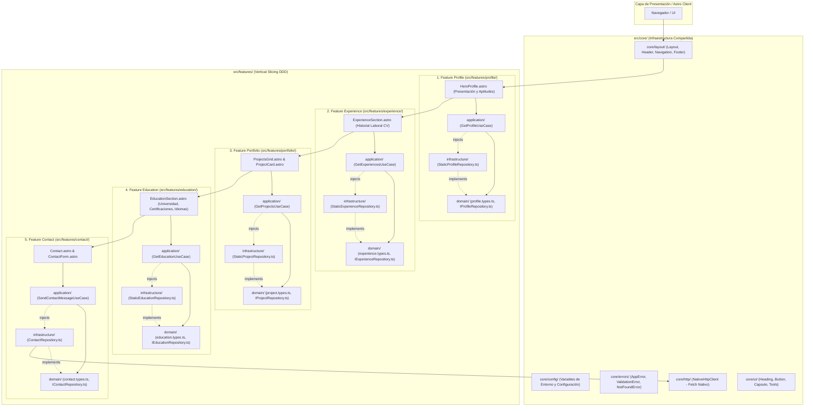

# 🏛️ Documento de Arquitectura de Software
**Proyecto:** Portafolio Profesional de David Solorza  
**Versión:** 2026.3.2  
**Autor:** Agente 2 - Staff Software Architect  
**Estado:** Aprobado / En Producción  

---

## 1. Resumen Ejecutivo
El presente documento define la arquitectura técnica y el diseño estructural integral del portafolio profesional de **David Solorza**, refactorizado bajo los paradigmas de **Domain-Driven Design (DDD)**, **Vertical Slicing** y principios **SOLID** (haciendo énfasis riguroso en S, I y D):
1. **Vertical Slicing Absoluto:** Cada característica funcional del sistema está aislada en su propio directorio vertical (`src/features/[feature]/`) conteniendo sus capas de `domain`, `application` e `infrastructure`.
2. **SOLID (Énfasis en S, I, D):**
   - **S (Single Responsibility Principle):** Cada caso de uso en la capa de aplicación (`application/*.usecase.ts`) orquesta una sola acción de negocio con un propósito atómico delimitado.
   - **I (Interface Segregation Principle):** Los contratos de tipos en `domain/*.types.ts` definen interfaces cohesivas y especializadas, evitando dependencias innecesarias de métodos o atributos que los consumidores no utilizan.
   - **D (Dependency Inversion Principle):** Las capas de presentación y casos de uso dependen exclusivamente de abstracciones/interfaces (`domain/I*Repository.ts`), nunca de implementaciones concretas.
3. **Cero SDKs Comerciales:** Toda interacción de red se realiza mediante el cliente HTTP nativo basado en la Fetch API pura (`src/core/http/httpClient.ts`).
4. **Flujos y Experiencia Preservados:** La secuencia estricta del CV (Presentación ➡️ Experiencias ➡️ Proyectos ➡️ Formación ➡️ Contacto), con soporte bilingüe reactivo (inglés por defecto) y modo claro por defecto.

---

## 2. Diagrama de Componentes y Flujo DDD (Mermaid)

---

## 3. Matriz de Aplicación de Principios SOLID

| Principio | Manifestación en el Código | Beneficio Arquitectónico |
| :--- | :--- | :--- |
| **S - Single Responsibility** | Casos de uso atómicos (`GetProfileUseCase`, `GetExperiencesUseCase`, `GetProjectsUseCase`, `GetEducationUseCase`, `SendContactMessageUseCase`). | Cada clase u objeto responde a un solo actor y motivo de cambio. |
| **O - Open/Closed** | Repositorios extensibles (`IProfileRepository`, `IProjectRepository`, etc.) admiten nuevas fuentes de datos (ej. DB Postgres, REST API remota) sin modificar los casos de uso ni las vistas. | Extensión limpia de funcionalidad sin alterar código testeado. |
| **L - Liskov Substitution** | Las implementaciones estáticas e HTTP implementan cabalmente las promesas y tipos definidos en sus respectivas interfaces. | Intercambiabilidad transparente entre entornos de desarrollo, mock y producción. |
| **I - Interface Segregation** | Tipado granular (`IProfile`, `ITechnologySkill`, `IWorkExperience`, `IEducationRecord`, `ILanguage`, `IContactMessage`, `IContactChannels`). | Los componentes no dependen de propiedades o contratos que no consumen. |
| **D - Dependency Inversion** | Las capas UI y Application dependen de interfaces (`I*Repository.ts`), nunca de librerías concretas ni llamadas directas de bajo nivel. | Máximo desacoplamiento, testabilidad unitaria y respeto por las capas limpias. |

---

## 4. Registro de Decisiones de Arquitectura (ADR)

### ADR 001: Desacoplamiento de Features en Vertical Slices Autónomas
- **Contexto:** Las secciones del portafolio se encontraban previamente acopladas en capas genéricas y archivos con responsabilidades mixtas.
- **Decisión:** Descomponer el sistema en 5 vertical slices (`profile`, `experience`, `portfolio`, `education`, `contact`), cada una con su estructura `domain/`, `application/` e `infrastructure/`.
- **Consecuencias:** Cohesión alta, eliminación de dependencias circulares, facilidad para aislar pruebas y modularidad total.

### ADR 002: Inversión de Dependencias (DIP) y Casos de Uso
- **Contexto:** Los componentes `.astro` realizaban transformaciones de datos directamente en el frontmatter, generando acoplamiento fuerte a colecciones o archivos locales.
- **Decisión:** Implementar un caso de uso específico (`*UseCase`) para cada operación de negocio que recibe por inyección de dependencias el contrato del repositorio (`I*Repository`).
- **Consecuencias:** Las vistas se convierten en componentes puramente declarativos de presentación. Cualquier cambio en la persistencia o API se aísla en la infraestructura.

### ADR 003: Prohibición Absoluta de SDKs Comerciales y Consumo Nativo
- **Contexto:** El Contrato de Gobernanza Técnica prohíbe el uso de SDKs empaquetados de terceros.
- **Decisión:** Toda llamada externa se centraliza en `src/core/http/httpClient.ts` utilizando la Fetch API nativa del estándar ECMAScript.
- **Consecuencias:** Cero sobrecosto de bundle, máxima seguridad y control total sobre headers y códigos HTTP.

### ADR 004: Modo Claro por Defecto y Bilingüismo (Inglés Primario)
- **Contexto:** El usuario solicitó explícitamente modo claro predeterminado y contenido en inglés por defecto para alineación internacional.
- **Decisión:** Inyección de script síncrono inline bloqueante en `<head>` (`Layout.astro`) que inicializa el tema en `light` y el idioma en `en` ante la ausencia de preferencia previa del usuario.
- **Consecuencias:** Cero parpadeo (FOIT/FOUC), óptima accesibilidad visual inmediata y alineación con estándares globales.
